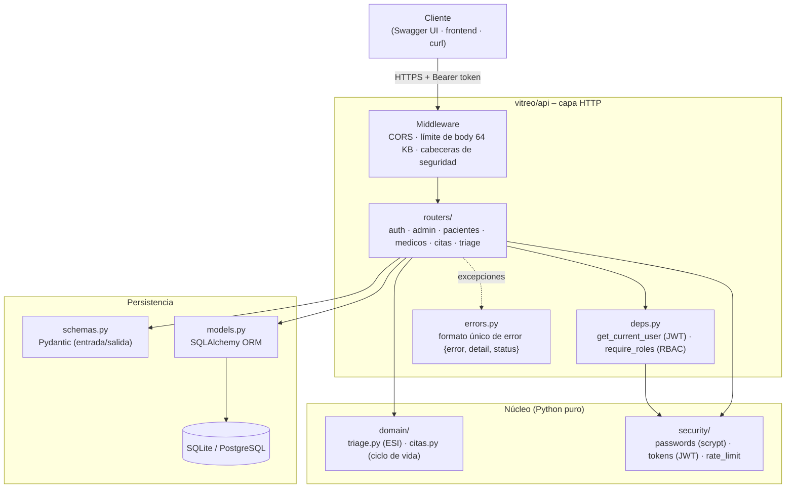
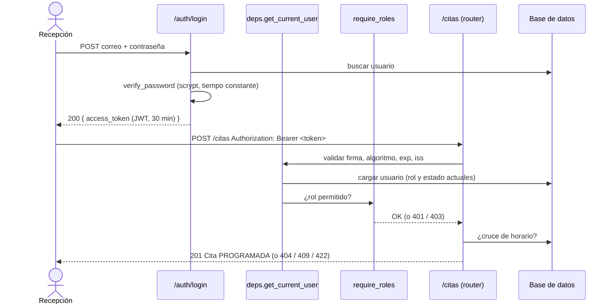
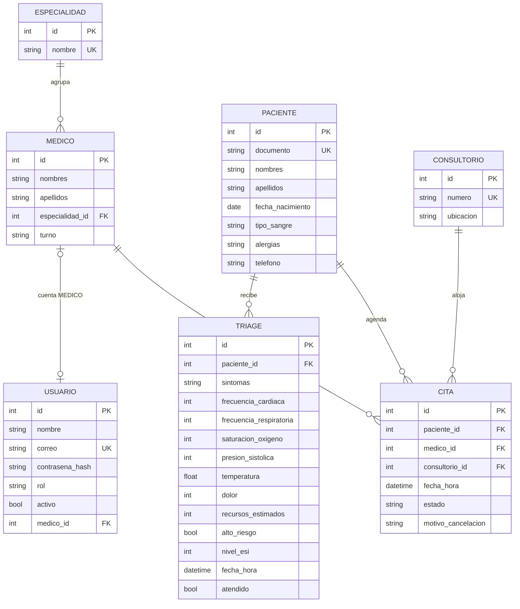
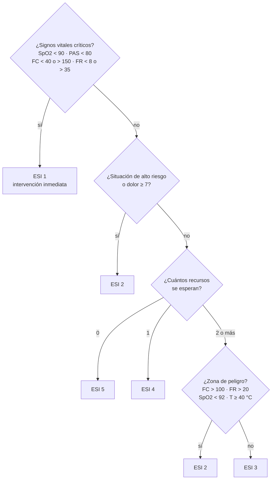
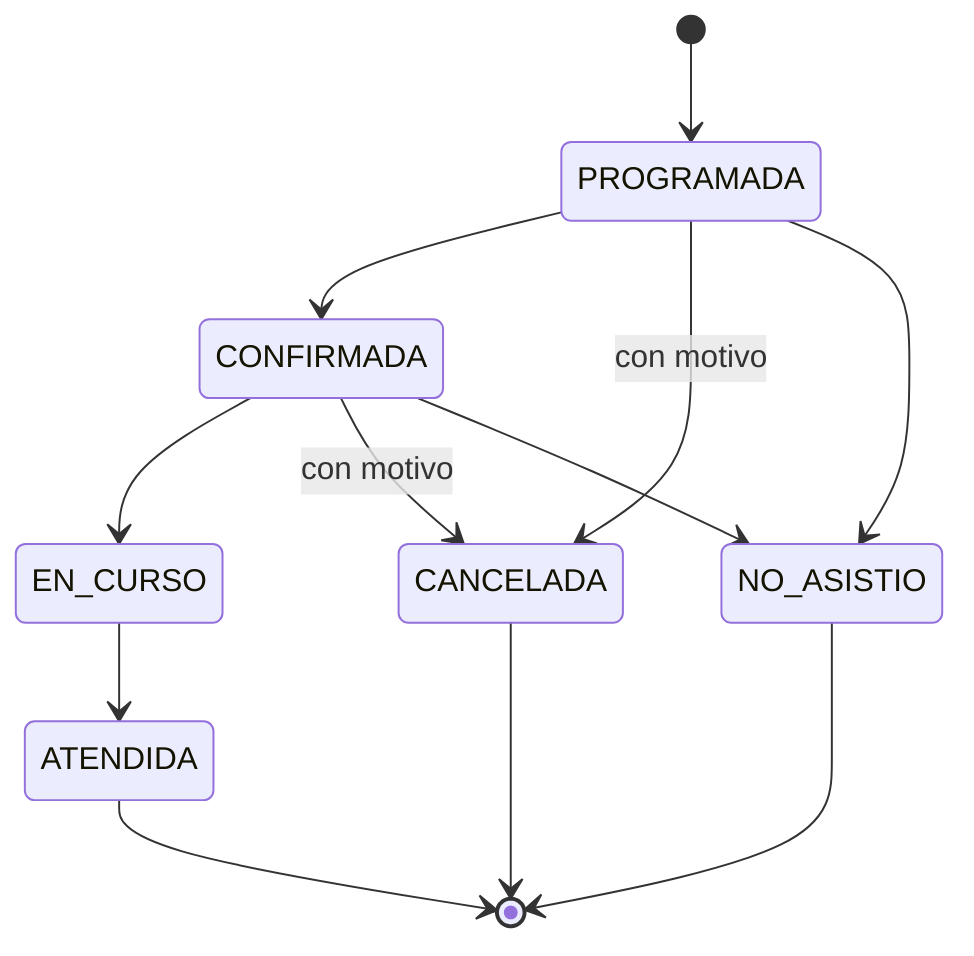
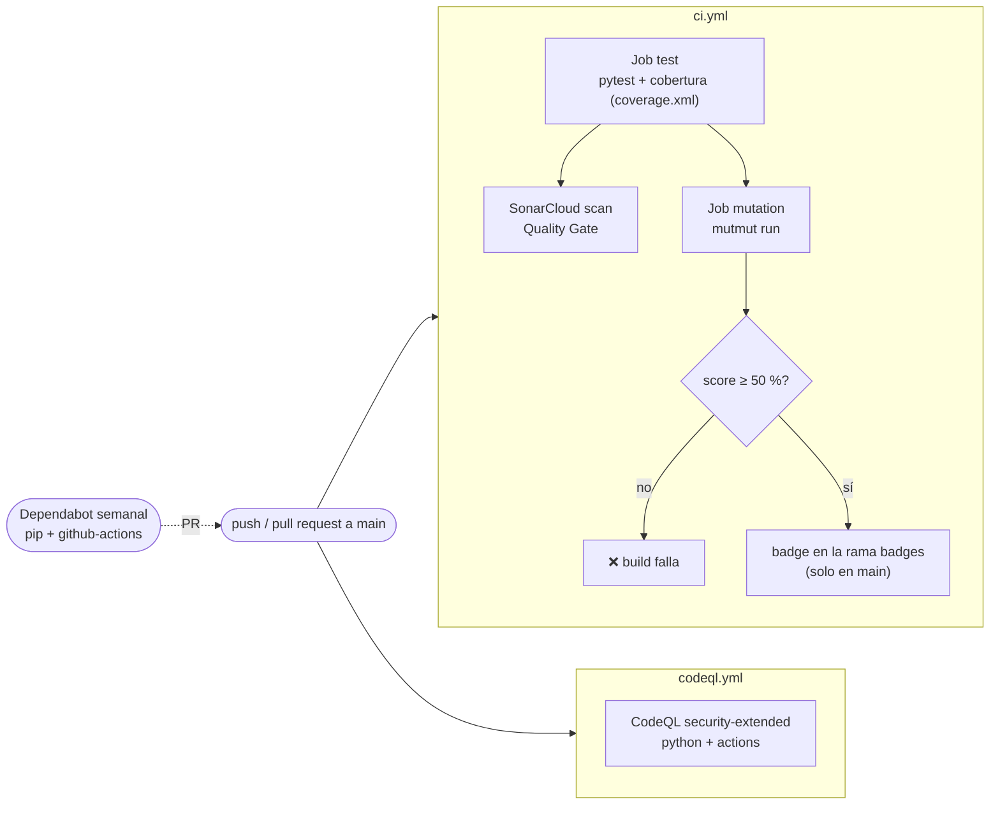

# Vitreo – Gestión de Citas y Triage Médico

[](https://github.com/SebastianTavera/Guia7-taller-de-programacion/actions/workflows/ci.yml)
[](https://github.com/SebastianTavera/Guia7-taller-de-programacion/actions/workflows/ci.yml)
[](https://sonarcloud.io/summary/new_code?id=SebastianTavera_Guia7-taller-de-programacion)
[](https://sonarcloud.io/summary/new_code?id=SebastianTavera_Guia7-taller-de-programacion)
[](https://github.com/SebastianTavera/Guia7-taller-de-programacion/actions/workflows/codeql.yml)


**Vitreo** es el proyecto semestral de Taller de Programación (UMB, 2026-262): una API REST para
organizar las **citas médicas** y el **triage de urgencias** de un centro de salud. Centraliza el
registro de pacientes, la agenda por especialidad, médico y consultorio, y la clasificación
automática de la urgencia con la escala **ESI (Emergency Severity Index, 1 = máxima, 5 = mínima)**.

Este repositorio corresponde a la **Guía 7 (Sesiones 13 y 14): Calidad DevSecOps, seguridad en
APIs y GitHub Advanced Security**. Incluye SonarCloud, mutation testing con mutmut, autenticación
JWT con RBAC, controles OWASP API Security Top 10 2023, CodeQL y Dependabot.

**Integrantes:** Joan Sebastián Romana · Javier Alejandro Castro · Juan Gámez Nieto

---

## Tabla de contenido

1. [Funcionalidades](#1-funcionalidades)
2. [Stack tecnológico](#2-stack-tecnológico)
3. [Arquitectura](#3-arquitectura)
4. [Modelo de datos](#4-modelo-de-datos)
5. [Reglas de negocio](#5-reglas-de-negocio)
6. [Seguridad](#6-seguridad)
7. [Instalación y ejecución](#7-instalación-y-ejecución)
8. [Uso de la API](#8-uso-de-la-api)
9. [Pruebas y calidad](#9-pruebas-y-calidad)
10. [Pipeline CI/CD (DevSecOps)](#10-pipeline-cicd-devsecops)
11. [Estructura del proyecto](#11-estructura-del-proyecto)
12. [Documentación de la Guía 7](#12-documentación-de-la-guía-7)
13. [Solución de problemas](#13-solución-de-problemas)
14. [Referencias](#14-referencias)

---

## 1. Funcionalidades

| Requerimiento funcional | Cómo lo cubre la API |
|---|---|
| RF1 – Registrar pacientes | `POST /api/v1/pacientes` (documento único, tipo de sangre, alergias) |
| RF2 – Agendar cita por especialidad, médico y horario | `POST /api/v1/citas`, que rechaza horarios cruzados del médico o del consultorio |
| RF3 – Cancelar cita con motivo | `POST /api/v1/citas/{id}/cancelar` (el motivo es obligatorio) |
| RF4 – Reprogramar cita | `POST /api/v1/citas/{id}/reprogramar`; la cita vuelve a `PROGRAMADA` |
| RF6 – Agenda del médico | `GET /api/v1/citas`: un `MEDICO` solo ve sus propias citas |
| RF7 – Registrar triage (síntomas y signos vitales) | `POST /api/v1/triage` |
| RF8 – Clasificación automática ESI 1–5 | Se calcula en el servidor con [`clasificar_esi`](vitreo/domain/triage.py) |
| RF9 – Cola de urgencias priorizada | `GET /api/v1/triage/cola`, ordenada por nivel ESI y luego por hora de llegada |
| RF14 – Médicos por especialidad | `GET /api/v1/medicos?especialidad_id=` |
| RF15 – Reportes | `GET /api/v1/admin/reportes`: citas por estado, triage por nivel y total de pacientes |
| RNF6 – Auditoría | Logs `vitreo.audit` (logins) y `vitreo.alerts` (triage crítico ESI 1–2) |
| RNF14 – Autenticación con roles | JWT + RBAC con `ADMIN`, `MEDICO`, `ENFERMERIA` y `RECEPCION` |

Diagnósticos, recetas, derivaciones y recordatorios (RF5, RF10–RF13) están en el modelo
entidad-relación del proyecto y quedan para las siguientes entregas.

## 2. Stack tecnológico

| Capa | Tecnología | Uso |
|---|---|---|
| Lenguaje | Python 3.12 | Requerimiento no funcional 16 |
| API | FastAPI 0.162 + Uvicorn | Endpoints REST, OpenAPI/Swagger, inyección de dependencias |
| Validación | Pydantic 2 | Schemas de entrada y salida, rangos de signos vitales |
| Persistencia | SQLAlchemy 2 + SQLite | ORM; con `DATABASE_URL` se puede cambiar a PostgreSQL |
| Seguridad | PyJWT, `hashlib.scrypt` | Tokens HS256 y hash de contraseñas |
| Pruebas | pytest, pytest-cov, httpx2 | Pruebas unitarias y de integración, cobertura |
| Mutation testing | mutmut 3.8 | Calidad de las pruebas |
| Calidad estática | SonarCloud | Bugs, vulnerabilidades, code smells, Quality Gate |
| Seguridad del repo | CodeQL, Dependabot | SAST y actualización de dependencias |
| CI/CD | GitHub Actions | Pipeline en cada push y PR |

## 3. Arquitectura

La aplicación sigue una **arquitectura en capas**. Las reglas de negocio y el núcleo de
seguridad son **funciones puras sin dependencias de FastAPI ni de la base de datos**. Eso las hace
fáciles de probar y es justo donde se concentra el mutation testing.



| Capa | Responsabilidad | Depende de |
|---|---|---|
| `api/main.py` | Crea la app, registra middleware, CORS, manejadores de error y routers | todo lo demás |
| `api/deps.py` | Sesión de BD por request, autenticación JWT y autorización por rol | `security`, `models` |
| `api/routers/*` | Un archivo por recurso; orquesta validación, reglas y persistencia | `domain`, `schemas`, `models` |
| `domain/*` | Reglas de negocio puras (ESI, transiciones de estado, ventana de agenda) | nada |
| `security/*` | Hash de contraseñas, JWT y limitador de intentos de login | `config` |
| `schemas.py` | Contratos de la API: validan la entrada y filtran la salida | `domain`, `models` |
| `models.py`, `db.py` | Tablas ORM, engine y sesión | `config` |
| `config.py` | Configuración desde variables de entorno (`.env`) | – |

### Flujo de una petición autenticada



## 4. Modelo de datos

Primera iteración del MER del proyecto ([models.py](vitreo/models.py)). En SQLite se activan las
llaves foráneas (`PRAGMA foreign_keys=ON`) para garantizar la integridad referencial (RNF12).



## 5. Reglas de negocio

### 5.1 Clasificación ESI (adultos)

Implementación simplificada de los puntos de decisión del algoritmo ESI v4 (Gilboy et al., 2011),
en [vitreo/domain/triage.py](vitreo/domain/triage.py):



Los niveles 1 y 2 se marcan como `critico: true` y generan una alerta en el log `vitreo.alerts`.
La cola de urgencias muestra los triages no atendidos ordenados por `nivel_esi` y luego por
`fecha_hora`.

### 5.2 Ciclo de vida de una cita



- Cada cita dura **30 minutos**. No se permite otra cita que se cruce con el mismo **médico** o el
  mismo **consultorio**; las citas consecutivas (9:00 y 9:30) sí se permiten.
- Las citas `CANCELADA` y `NO_ASISTIO` liberan el horario.
- Solo las citas `PROGRAMADA` o `CONFIRMADA` se pueden reprogramar; al moverla vuelve a
  `PROGRAMADA` para que se confirme de nuevo.
- La fecha de la cita debe estar en el futuro, y la fecha de nacimiento en el pasado.

## 6. Seguridad

### 6.1 Autenticación y autorización

- **Contraseñas:** scrypt con sal aleatoria (n=2^14, r=8, p=1), comparación en tiempo constante.
  Nunca se guardan ni se devuelven en texto plano.
- **JWT HS256:** incluye los claims `sub`, `rol`, `iat`, `exp` (30 min) e `iss`. Al validarlo se
  exige el algoritmo HS256, así que un token con `alg: none` se rechaza.
- **Rol leído de la BD en cada petición:** un token que diga `rol: ADMIN` no sirve si el usuario
  no lo es, y desactivar a un usuario invalida sus tokens al instante.
- **Bloqueo por fuerza bruta:** 5 intentos fallidos en 5 minutos devuelven `429` con `Retry-After`.

### 6.2 Matriz de permisos

| Recurso | ADMIN | MEDICO | ENFERMERIA | RECEPCION |
|---|:-:|:-:|:-:|:-:|
| Usuarios y reportes | ✅ | ❌ | ❌ | ❌ |
| Registrar pacientes | ✅ | ❌ | ❌ | ✅ |
| Consultar pacientes y médicos | ✅ | ✅ | ✅ | ✅ |
| Agendar, cancelar y reprogramar citas | ✅ | ❌ | ❌ | ✅ |
| Cambiar estado de una cita | ✅ | solo propias | ❌ | ✅ |
| Ver citas | ✅ | solo propias | ✅ | ✅ |
| Registrar triage | ✅ | ❌ | ✅ | ❌ |
| Ver cola de urgencias | ✅ | ✅ | ✅ | ❌ |
| Marcar triage como atendido | ❌ | ✅ | ✅ | ❌ |

### 6.3 OWASP API Security Top 10 (2023)

Hay 12 controles que cubren 8 de las 10 categorías. La tabla completa, en inglés y con evidencia de
código y de pruebas, está en [docs/sesion14/owasp-api-top10-2023.md](docs/sesion14/owasp-api-top10-2023.md).

| Riesgo | Control |
|---|---|
| API1 BOLA | Un médico solo accede a sus citas; las ajenas devuelven 404 para que no se puedan enumerar ids |
| API2 Broken Authentication | scrypt, hash señuelo para correos inexistentes, mensaje de error genérico, JWT estricto, bloqueo por intentos |
| API3 Property Level Authorization | `extra="forbid"` contra mass assignment; las respuestas nunca incluyen el hash |
| API4 Resource Consumption | Body máximo de 64 KB, paginación hasta 100, longitudes máximas, limitador con memoria acotada |
| API5 Function Level Authorization | `require_roles(...)` en cada endpoint sensible |
| API6 Sensitive Business Flows | Solo el personal agenda citas; la agenda impide cruces y acaparamiento de horarios |
| API8 Security Misconfiguration | CSP, `X-Frame-Options`, `nosniff`, `no-store`, HSTS en producción, CORS con lista blanca, errores sin detalles internos |
| API9 Inventory Management | Rutas versionadas `/api/v1`, OpenAPI apagado en producción, Dependabot y CodeQL |

## 7. Instalación y ejecución

### 7.1 Requisitos

- Python **3.12** o superior
- Git
- Para mutation testing en local: Linux, macOS o **WSL** (mutmut no funciona en Windows nativo)

### 7.2 Clonar e instalar

```bash
git clone https://github.com/SebastianTavera/Guia7-taller-de-programacion.git
cd Guia7-taller-de-programacion
python -m venv .venv
```

Activar el entorno virtual:

```powershell
# Windows (PowerShell)
.venv\Scripts\Activate.ps1
```

```bash
# Linux / macOS / WSL
source .venv/bin/activate
```

Instalar dependencias:

```bash
pip install -r requirements-dev.txt   # app + pruebas + mutmut
# o solo la app:
pip install -r requirements.txt
```

### 7.3 Variables de entorno

```bash
cp .env.example .env            # Windows: copy .env.example .env
python -c "import secrets; print(secrets.token_urlsafe(48))"   # pega el resultado en JWT_SECRET
```

| Variable | Por defecto | Descripción |
|---|---|---|
| `APP_ENV` | `development` | Con `production` se desactivan `/docs` y `/openapi.json`, se activa HSTS y `JWT_SECRET` pasa a ser obligatorio |
| `DATABASE_URL` | `sqlite:///./vitreo.db` | URL de SQLAlchemy (por ejemplo `postgresql+psycopg://...`) |
| `JWT_SECRET` | aleatorio por proceso | Clave de firma, mínimo 32 caracteres. Si no se define en desarrollo, los tokens dejan de servir al reiniciar |
| `JWT_EXPIRE_MINUTES` | `30` | Vigencia del token |
| `CORS_ORIGINS` | `http://localhost:5500` | Orígenes permitidos, separados por coma |
| `SEED_PASSWORD` | – | Contraseña de los usuarios demo (mínimo 12 caracteres) |

El archivo `.env` está en `.gitignore`: los secretos nunca se suben al repositorio.

### 7.4 Datos de demostración

```bash
python -m vitreo.seed
```

Crea 5 especialidades, 5 médicos, 5 consultorios, 5 pacientes y un usuario por rol, todos con la
contraseña `SEED_PASSWORD`:

| Usuario | Rol |
|---|---|
| `admin@vitreo.local` | ADMIN |
| `anieto@vitreo.local` | MEDICO (Dr. Andrés Nieto, Cardiología) |
| `enfermeria@vitreo.local` | ENFERMERIA |
| `recepcion@vitreo.local` | RECEPCION |

### 7.5 Levantar la API

```bash
uvicorn vitreo.api.main:app --reload
```

| URL | Contenido |
|---|---|
| http://localhost:8000/docs | Swagger UI (interactivo) |
| http://localhost:8000/redoc | ReDoc |
| http://localhost:8000/openapi.json | Contrato OpenAPI |
| http://localhost:8000/health | Health check |

### 7.6 Resumen de comandos

| Tarea | Comando |
|---|---|
| Instalar | `pip install -r requirements-dev.txt` |
| Datos demo | `python -m vitreo.seed` |
| Ejecutar API | `uvicorn vitreo.api.main:app --reload` |
| Pruebas | `pytest` |
| Pruebas + cobertura | `pytest --cov --cov-report=term-missing` |
| Reporte HTML de cobertura | `pytest --cov --cov-report=html` (abre `htmlcov/index.html`) |
| Una sola prueba | `pytest tests/test_auth_api.py -k lockout` |
| Mutation testing (Linux/WSL) | `mutmut run` |
| Ver mutantes sobrevivientes | `mutmut results` y `mutmut show <nombre>` |
| Umbral de mutación | `mutmut export-cicd-stats && python scripts/check_mutation_score.py --min 50` |

## 8. Uso de la API

Todos los errores tienen el mismo formato:

```json
{ "error": "Forbidden", "detail": "Your role is not allowed to perform this action.", "status": 403 }
```

### 8.1 Endpoints

| Método | Ruta | Roles | Respuestas |
|---|---|---|---|
| POST | `/api/v1/auth/login` | público | 200, 401, 422, 429 |
| GET | `/api/v1/auth/me` | cualquier usuario autenticado | 200, 401 |
| POST | `/api/v1/admin/usuarios` | ADMIN | 201, 401, 403, 404, 409, 422 |
| GET | `/api/v1/admin/usuarios?skip=&limit=` | ADMIN | 200, 401, 403 |
| GET | `/api/v1/admin/reportes` | ADMIN | 200, 401, 403 |
| POST | `/api/v1/pacientes` | RECEPCION, ADMIN | 201, 401, 403, 409, 422 |
| GET | `/api/v1/pacientes?q=&skip=&limit=` | autenticado | 200, 401 |
| GET | `/api/v1/pacientes/{id}` | autenticado | 200, 401, 404 |
| GET | `/api/v1/medicos?especialidad_id=` | autenticado | 200, 401 |
| POST | `/api/v1/citas` | RECEPCION, ADMIN | 201, 401, 403, 404, 409, 422 |
| GET | `/api/v1/citas?fecha=&medico_id=&estado=` | autenticado (MEDICO: solo propias) | 200, 401 |
| GET | `/api/v1/citas/{id}` | autenticado (MEDICO: solo propias) | 200, 401, 404 |
| PATCH | `/api/v1/citas/{id}/estado` | MEDICO (propias), RECEPCION, ADMIN | 200, 401, 403, 404, 409, 422 |
| POST | `/api/v1/citas/{id}/cancelar` | RECEPCION, ADMIN | 200, 401, 403, 404, 409, 422 |
| POST | `/api/v1/citas/{id}/reprogramar` | RECEPCION, ADMIN | 200, 401, 403, 404, 409, 422 |
| POST | `/api/v1/triage` | ENFERMERIA, ADMIN | 201, 401, 403, 404, 422 |
| GET | `/api/v1/triage/cola` | ENFERMERIA, MEDICO, ADMIN | 200, 401, 403 |
| POST | `/api/v1/triage/{id}/atender` | MEDICO, ENFERMERIA | 200, 401, 403, 404, 409 |
| GET | `/health` | público | 200 |

### 8.2 Ejemplo completo con curl

```bash
# 1. Login (recepción)
TOKEN=$(curl -s -X POST localhost:8000/api/v1/auth/login \
  -H "Content-Type: application/json" \
  -d '{"correo":"recepcion@vitreo.local","password":"<SEED_PASSWORD>"}' | python -c "import sys,json;print(json.load(sys.stdin)['access_token'])")

# 2. Perfil (endpoint USER) -> 200
curl -s localhost:8000/api/v1/auth/me -H "Authorization: Bearer $TOKEN"

# 3. Endpoint ADMIN con token de recepción -> 403
curl -s localhost:8000/api/v1/admin/usuarios -H "Authorization: Bearer $TOKEN"

# 4. Agendar una cita
curl -s -X POST localhost:8000/api/v1/citas -H "Authorization: Bearer $TOKEN" \
  -H "Content-Type: application/json" \
  -d '{"paciente_id":1,"medico_id":1,"consultorio_id":5,"fecha_hora":"2026-12-01T09:00:00"}'
```

Ejemplo de triage (con un token de `enfermeria@vitreo.local`):

```json
POST /api/v1/triage
{
  "paciente_id": 1,
  "sintomas": "Dolor torácico agudo, disnea",
  "frecuencia_cardiaca": 118,
  "frecuencia_respiratoria": 24,
  "saturacion_oxigeno": 88,
  "presion_sistolica": 95,
  "temperatura": 37.2,
  "dolor": 8,
  "recursos_estimados": 3,
  "alto_riesgo": true
}
```

La respuesta trae `"nivel_esi": 1` y `"critico": true` (SpO2 por debajo de 90 %).

## 9. Pruebas y calidad

| Tipo | Ubicación | Qué cubre |
|---|---|---|
| Unitarias | [tests/unit/](tests/unit/) | Cada umbral ESI en ambos lados de la frontera, transiciones de cita, scrypt, JWT (expirado, `alg: none`, emisor, claims), limitador de login con reloj simulado |
| Integración | [tests/test_*_api.py](tests/) | Endpoints con base de datos SQLite en memoria: matriz 401/403/200, BOLA, mass assignment, cruces de agenda, cola de urgencias, cabeceras de seguridad, límite de body |

- **154 pruebas, 100 % de cobertura** de líneas.
- Las pruebas no necesitan red ni secretos: usan una base de datos en memoria y un `JWT_SECRET`
  aleatorio por ejecución.

### Mutation testing

mutmut modifica el código (por ejemplo `<` → `<=`, `True` → `False` o constantes) y comprueba que
alguna prueba falle. El alcance se define en `[tool.mutmut]` de [pyproject.toml](pyproject.toml):
`vitreo/domain/*` y `vitreo/security/{passwords,tokens,rate_limit}.py`.

| Ejecución | Mutantes | Muertos | Score |
|---|---|---|---|
| Suite inicial | 177 | 173 | 97,7 % |
| Con las pruebas añadidas tras el análisis | 177 | 176 | **99,4 %** (el sobreviviente es un mutante equivalente) |

El análisis de cada mutante sobreviviente está en [docs/sesion13/mutation-testing.md](docs/sesion13/mutation-testing.md).

## 10. Pipeline CI/CD (DevSecOps)



| Workflow | Disparador | Qué hace |
|---|---|---|
| [ci.yml](.github/workflows/ci.yml) → `test` | push y PR a `main` | Pruebas con cobertura y análisis de SonarCloud (se salta si no existe el secret `SONAR_TOKEN`) |
| [ci.yml](.github/workflows/ci.yml) → `mutation` | después de `test` | `mutmut run`, umbral del 50 % con [check_mutation_score.py](scripts/check_mutation_score.py), resumen en el job y badge |
| [codeql.yml](.github/workflows/codeql.yml) | push, PR y cada lunes | SAST de Python y de los workflows |
| [dependabot.yml](.github/dependabot.yml) | semanal | PRs de actualización de pip y de GitHub Actions |

Todos los workflows declaran permisos mínimos (`contents: read`). Solo el job de mutación pide
`contents: write`, para publicar el badge.

### Configuración única en GitHub y SonarCloud

1. **SonarCloud:** importar el repositorio en la organización `sebastiantavera` y desactivar
   *Administration → Analysis Method → Automatic Analysis*. Después, generar un token en
   *My Account → Security*.
2. **GitHub → Settings → Secrets and variables → Actions:** crear el secret `SONAR_TOKEN`.
3. **GitHub → Settings → Code security:** activar *Dependabot alerts* y *Dependabot security
   updates*. No activar el *Default setup* de CodeQL, porque este repo ya usa el workflow avanzado.

## 11. Estructura del proyecto

```
Guia7-taller-de-programacion/
├── .github/
│   ├── workflows/
│   │   ├── ci.yml                  # pruebas, SonarCloud, mutation testing y badge
│   │   └── codeql.yml              # análisis CodeQL (python + actions)
│   └── dependabot.yml              # actualizaciones semanales de pip y actions
├── vitreo/
│   ├── config.py                   # configuración desde variables de entorno
│   ├── db.py                       # engine, sesión, Base, PRAGMA foreign_keys
│   ├── models.py                   # ORM: Usuario, Paciente, Medico, Especialidad, Consultorio, Cita, Triage
│   ├── schemas.py                  # Pydantic: entrada (extra=forbid) y salida
│   ├── seed.py                     # datos de demostración
│   ├── domain/
│   │   ├── triage.py               # clasificación ESI y nivel crítico
│   │   └── citas.py                # estados, transiciones y ventana de conflicto
│   ├── security/
│   │   ├── passwords.py            # hash y verificación scrypt
│   │   ├── tokens.py               # emisión y validación de JWT
│   │   └── rate_limit.py           # bloqueo de login por intentos fallidos
│   └── api/
│       ├── main.py                 # create_app, middleware, CORS, routers, /health
│       ├── deps.py                 # get_db, get_current_user, require_roles, get_or_404
│       ├── errors.py               # manejadores globales de error
│       └── routers/
│           ├── auth.py             # /auth/login, /auth/me
│           ├── admin.py            # /admin/usuarios, /admin/reportes
│           ├── pacientes.py        # /pacientes
│           ├── medicos.py          # /medicos
│           ├── citas.py            # /citas (agenda, estados, cancelar, reprogramar)
│           └── triage.py           # /triage (registro, cola, atender)
├── tests/
│   ├── conftest.py                 # BD en memoria, cliente, catálogo, usuarios por rol
│   ├── unit/                       # dominio y núcleo de seguridad (objetivo de mutmut)
│   └── test_*_api.py               # integración por recurso + controles transversales
├── scripts/
│   └── check_mutation_score.py     # umbral de mutación para CI
├── docs/                           # entregables de la Guía 7 (ver sección 12)
├── .env.example                    # plantilla de variables de entorno
├── pyproject.toml                  # configuración de pytest, coverage y mutmut
├── requirements.txt                # dependencias de ejecución
├── requirements-dev.txt            # + pytest, pytest-cov, httpx2, mutmut
└── sonar-project.properties        # configuración de SonarCloud
```

## 12. Documentación de la Guía 7

| Documento | Contenido |
|---|---|
| [docs/README.md](docs/README.md) | Checklist de entregables con su peso en la nota |
| [docs/sesion13/sonarcloud.md](docs/sesion13/sonarcloud.md) | Métricas de SonarCloud, bugs corregidos y pruebas de regresión |
| [docs/sesion13/mutation-testing.md](docs/sesion13/mutation-testing.md) | Score, tabla de mutantes analizados y pruebas añadidas |
| [docs/sesion14/jwt-rbac.md](docs/sesion14/jwt-rbac.md) | Diseño JWT/RBAC, endpoints de prueba y demo (en inglés) |
| [docs/sesion14/owasp-api-top10-2023.md](docs/sesion14/owasp-api-top10-2023.md) | 12 controles OWASP con evidencia (en inglés) |
| [docs/sesion14/codeql-dependabot.md](docs/sesion14/codeql-dependabot.md) | Configuración y registro de alertas (en inglés) |
| [docs/glossary.md](docs/glossary.md) | Glosario inglés–español de las sesiones |
| [docs/video-script.md](docs/video-script.md) | Guion del video en inglés |
| [docs/ai-assistant-log.md](docs/ai-assistant-log.md) | Registro de sugerencias de IA evaluadas |
| `docs/evidencias/` | Capturas para el informe |

## 13. Solución de problemas

| Problema | Solución |
|---|---|
| `To run mutmut on Windows, please use the WSL` | Usar WSL (`wsl --install`) o revisar el resultado en el job `mutation` de GitHub Actions |
| Los tokens dejan de servir al reiniciar | Falta `JWT_SECRET` en `.env`; en desarrollo se genera uno aleatorio en cada arranque |
| `RuntimeError: JWT_SECRET must have at least 32 characters` | Con `APP_ENV=production` el secreto es obligatorio |
| `/docs` devuelve 404 | `APP_ENV=production` desactiva la documentación a propósito |
| Login devuelve 429 | Hubo 5 intentos fallidos en 5 minutos; esperar el tiempo que indica `Retry-After` |
| `The database already has users` al correr el seed | El seed solo corre sobre una base vacía; borrar `vitreo.db` para empezar de cero |
| El scan de SonarCloud falla con *Automatic Analysis* | Desactivar el análisis automático en SonarCloud |
| Error 422 con `fecha_hora` | La fecha debe estar en el futuro, en formato ISO 8601 (`2026-12-01T09:00:00`) |

## 14. Referencias

- Gilboy, N., Tanabe, P., Travers, D., & Rosenau, A. M. (2011). *Emergency Severity Index (ESI): A triage tool for emergency department care, version 4*. Agency for Healthcare Research and Quality.
- OWASP Foundation. (2023). *OWASP API Security Top 10 – 2023*. https://owasp.org/API-Security/editions/2023/en/0x11-t10/
- Jones, M., Bradley, J., & Sakimura, N. (2015). *JSON Web Token (JWT)* (RFC 7519). IETF. https://doi.org/10.17487/RFC7519
- Percival, C., & Josefsson, S. (2016). *The scrypt password-based key derivation function* (RFC 7914). IETF. https://doi.org/10.17487/RFC7914
- Jia, Y., & Harman, M. (2011). An analysis and survey of the development of mutation testing. *IEEE Transactions on Software Engineering, 37*(5), 649–678. https://doi.org/10.1109/TSE.2010.62
- FastAPI. (2026). *FastAPI documentation*. https://fastapi.tiangolo.com/
- GitHub. (2026). *About code scanning with CodeQL*. https://docs.github.com/code-security/code-scanning
